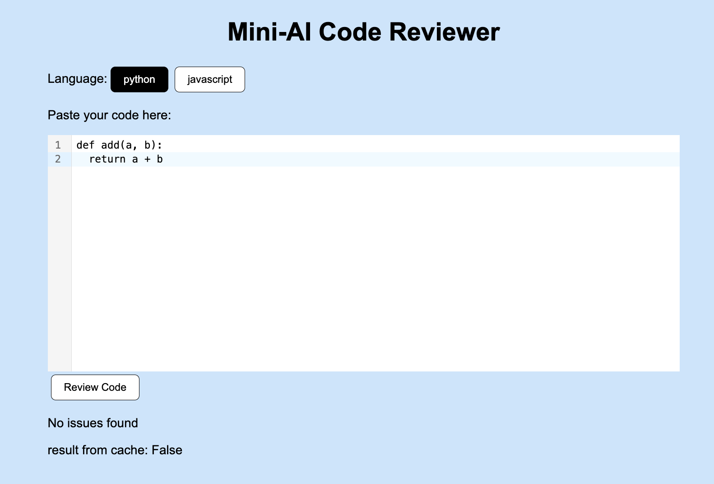
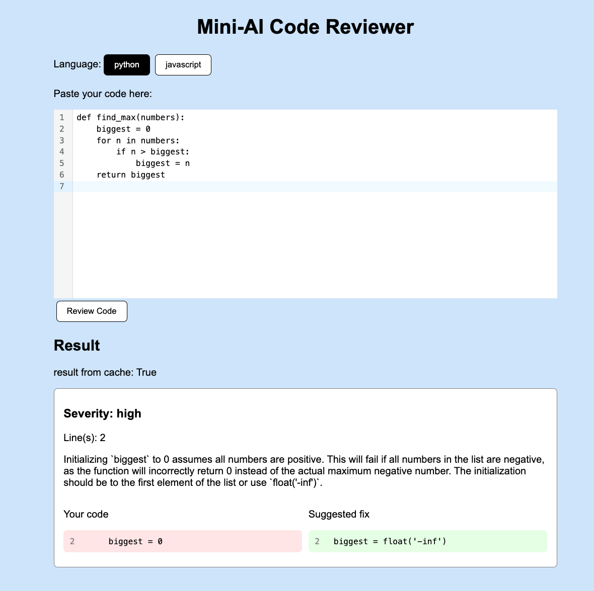

# Mini-AI Code Reviewer

A web app where a user pastes a code snippet, selects the language, and the AI identifies logic errors. It support Python and Javascript

- Frontend: React + TypeScript + Vite, zustand for state
- Backend: Python FastAPI
- LLM: any OpenAI compatible API. This example use local Ollama `qwen3-coder:30b` model




## Quick start

### 1. Run the LLM

Install [Ollama](https://ollama.com/download), then:

```bash
ollama pull qwen3-coder:30b
```

The model is about 19 GB. If your computer is small you can use `qwen2.5-coder:7b` (4.7 GB), but the result is worse after evaluation.

### 2. Run with Docker

```bash
cp backend/.env.example backend/.env
docker compose up --build
```

- Frontend: http://localhost:5173
- Backend: http://localhost:8000 (API docs at http://localhost:8000/docs)

### Or run without Docker

Backend:

```bash
cd backend
python -m venv .venv
source .venv/bin/activate
pip install -r requirements.txt
cp .env.example .env
uvicorn app.main:app --reload
```

Frontend:

```bash
cd frontend
npm install
npm run dev
```

## Project structure

```
backend/app/                  FastAPI app (API, LLM gateway, prompt, cache)
backend/app/prompt_versions/  prompt v1, v2, v3
backend/tests/                unit tests
backend/eval/                 eval with real LLM
frontend/src/                 React app (components, store, api)
```

## Configuration

All setting is in `backend/.env`, see `.env.example` for the full list. The main ones:

- `LLM_BASE_URL`, `LLM_API_KEY`, `LLM_MODEL`: change these to use other provider like OpenAI, no code change needed
- `LLM_JSON_MODE`: force JSON output, only work on model that support it
- `LLM_PROMPT_VERSION`: which prompt in `app/prompt_versions/` to use (default `v2`)
- `CACHE_TTL_S`, `CACHE_MAX_ITEMS`: cache setting

## API

Full docs with "Try it out" at http://localhost:8000/docs.

| Method | Path | What it do |
|---|---|---|
| `POST` | `/lint` | Review the code and return logic errors |
| `GET` | `/languages` | List supported languages: `{"languages": ["python", "javascript"]}` |
| `GET` | `/health` | Check server is up: `{"status": "ok"}` |

### POST /lint

Request:

```json
{
  "language": "javascript",
  "code": "function last(arr) {\n  return arr[arr.length];\n}"
}
```

Response:

```json
{
  "issues": [
    {
      "line_start": 2,
      "line_end": 2,
      "severity": "high",
      "explanation": "`arr[arr.length]` return `undefined`, the last index is `arr.length - 1`.",
      "fix": "return arr[arr.length - 1];"
    }
  ],
  "cache": false
}
```

## How it work

- **Prompt**: code is sent with line number (`3| for i in ...`). The model only report logic errors, `fix` must be only code (no text like "change X to Y"), and answer must be JSON.
- **Response check**: backend validate the JSON with pydantic, retry up to 3 times if bad, and clamp line number back into the code.
- **AI gateway**: OpenAI client with custom `base_url`, so it work with Ollama or any OpenAI compatible API.
- **Cache**: in memory, key is hash of `model + prompt version + language + code`. Have TTL and max items, errors are not cached. For more than one backend I would move it to Redis because each backend has its own memory, so they can't share the cache.

## Tests and evaluation

Need Python and Node to run test&eval (tested with Python 3.15 & Node 26).

```bash
cd backend
python -m pytest tests -q     # unit tests with fake LLM
python -m eval.lint_eval      # eval with real LLM, need Ollama running and Node installed
```

The eval run 10 cases (Python and JS, short and long, buggy and clean). Each case check the bug is found on the right line (or nothing found on clean code), `fix` is real code (parsed by `ast` / `node --check`), and the language matter (`arr[-1]` is bug in JS but fine in Python).

| Model | Prompt | Score | Avg latency |
|---|---|---|---|
| **qwen3-coder:30b** | **v2** | **9/10** | **2.9s** |
| qwen3-coder:30b | v3 | 7/10 | 2.5s |
| qwen2.5-coder:7b | v2 | 6/10 | 2.4s |
| qwen2.5-coder:7b | v3 | 4/10 | 1.8s |

Prompt `v2` = only code in `fix` with good/bad example, no made up None issues. `v3` = v2 + one-shot example, it was worse because the model copy the example too much.

## Limits

- Model can still miss bugs, it's not 100%.
- Cache reset when server restart.
- First request is slow (~20s) because Ollama load the model.
